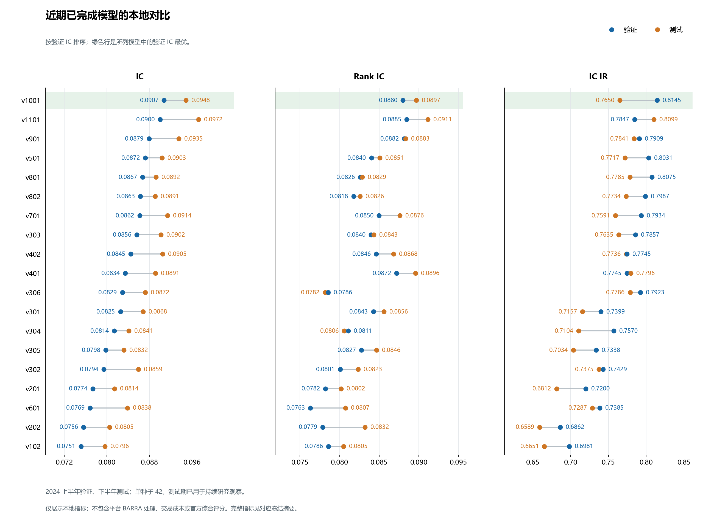

# 进益资本杯比赛资料

本仓库保存 BigQuant 2026 年进益资本杯端到端赛道的规则、数据说明、模型方案和冻结结果。比赛 ID：`45b41c7a-0ac8-42e9-9fe3-0c33dcfb9bca`。

## 冻结模型结果

本地研究采用 2020—2023 年训练、2024 年上半年验证、下半年测试；股票池和最低截面覆盖率均为 100%。截至 2026-10-22（UTC+08:00）本次归档，下表 35 个版本完成训练及双集评估，各模型保持原先选出的权重；完整指标和指纹见[冻结汇总](../experiments/completed-models-20261022.json)。

| 方案 | 参数量 | 验证 IC | 验证 Rank IC | 测试 IC | 测试 Rank IC | 结果 |
| --- | ---: | ---: | ---: | ---: | ---: | --- |
| [v1](baseline-v1.md) | 6,785 | 0.070445 | 0.061333 | 0.083549 | 0.068316 | 历史基线，测试 IC 高于 v4—v7 |
| [v2](../solutions/v2/README.md) | 428,673 | 0.034507 | 0.030664 | 0.032298 | 0.033902 | 未超过 v1 |
| [v3](../solutions/v3/README.md) | 1,591,553 | 0.044650 | 0.044401 | 0.037489 | 0.042015 | 超过 v2，未超过 v1 |
| [v4](../solutions/v4/README.md) | 1,591,553 | 0.069469 | 0.068725 | 0.073400 | 0.070554 | 超过 v3，按验证 IC 未晋级；输出未校准 |
| [v5](../solutions/v5/README.md) | 2,429,505 | 0.070462 | 0.069256 | 0.073423 | 0.071142 | 验证 IC 略高于 v1；单种子本地改善候选 |
| [v6](../solutions/v6/README.md) | 2,429,505 | 0.071842 | 0.067675 | 0.074766 | 0.069818 | 残差块 Dropout 0.35；单种子本地改善候选 |
| [v7](../solutions/v7/README.md) | 2,421,185 | 0.073347 | 0.069186 | 0.079857 | 0.073054 | 删除全部 LayerNorm；达到本地改善条件，属于单种子改善候选 |
| [v7a](../solutions/v7a/README.md) | 2,421,185 | 0.071049 | 0.068257 | 0.072793 | 0.071365 | 取消隐藏有效性掩码；未改善 |
| [v7b](../solutions/v7b/README.md) | 5,185,985 | 0.070615 | 0.068211 | 0.073789 | 0.068706 | 取消掩码并展平投影；未改善 |
| [v7c](../solutions/v7c/README.md) | 2,421,185 | 0.071914 | 0.065394 | 0.072922 | 0.068733 | 对称边界复制；未改善 |
| [v7d](../solutions/v7d/README.md) | 3,957,185 | 0.068719 | 0.063481 | 0.070115 | 0.066120 | 密集宽卷积；未改善 |
| [v7e](../solutions/v7e/README.md) | 2,421,185 | 0.076757 | 0.072320 | 0.079773 | 0.074215 | 截面标准化 Huber 与月内随机 batch；本地改善候选，测试 IC 略低于 v7 |
| [v7f](../solutions/v7f/README.md) | 2,422,721 | 0.072127 | 0.067488 | 0.076603 | 0.069432 | 预测时刻 one-hot；未改善 |
| [v8](../solutions/v8/README.md) | 6,723,521 | 0.070983 | 0.070475 | 0.078567 | 0.074808 | 六组修改整合；未改善 |
| [v9](../solutions/v9/README.md) | 25,458,401 | 0.067835 | 0.067583 | 0.077534 | 0.075617 | 三频固定交易日长窗口；未改善 |
| [v101](../solutions/v101/README.md) | 656,993 | 0.076741 | 0.079479 | 0.082303 | 0.083960 | 月内 FP32 迁移至全局 FP16 的 Patch Transformer；验证 IC 略低于 v7e，按用户要求导出平台测试材料 |
| [v102](../solutions/v102/README.md) | 770,465 | 0.075121 | 0.078604 | 0.079628 | 0.080502 | 时钟条件读出、从头全局训练；双集 IC 低于 v101 和 v301，不导出 |
| [v201](../solutions/v201/README.md) | 552,973 | 0.077352 | 0.078214 | 0.081427 | 0.080190 | 单种子改善候选，测试 IC IR 低于 v7e；已导出平台材料 |
| [v202](../solutions/v202/README.md) | 550,093 | 0.075618 | 0.077872 | 0.080511 | 0.083187 | Patch 压缩提高训练效率，但验证 IC 低于 v201、v301；不导出平台材料 |
| [v301](../solutions/v301/README.md) | 433,409 | 0.082544 | 0.084265 | 0.086791 | 0.085596 | 分层 GRU 基准；相对 v101 全部月份 IC 改善，9 月仍弱于 v7e |
| [v302](../solutions/v302/README.md) | 469,409 | 0.079400 | 0.080072 | 0.085915 | 0.082347 | 训练及逐轮验证耗时较 v301 少约 42%，IC IR 略好；验证 IC 未晋级，暂不导出 |
| [v303](../solutions/v303/README.md) | 433,409 | 0.085625 | 0.083970 | 0.090160 | 0.084293 | Huber delta=2 基准；相对 v301 全部月份 IC 改善，但 Rank IC 略低、换手代理增加 |
| [v304](../solutions/v304/README.md) | 491,297 | 0.081398 | 0.081085 | 0.084087 | 0.080573 | 时钟门控两级状态读出；双集 IC、Rank IC 低于 v301 和 v303，不导出 |
| [v305](../solutions/v305/README.md) | 440,609 | 0.079784 | 0.082750 | 0.083208 | 0.084647 | 较小片段压缩率；相对 v302 的 Rank IC 提高，但测试 IC、双集 IC IR 和耗时不占优，不导出 |
| [v306](../solutions/v306/README.md) | 433,409 | 0.082907 | 0.078575 | 0.087217 | 0.078165 | Huber delta=4；双集 IR 提高，但 IC／Rank IC 低于 v303，换手代理结果不一致，不导出 |
| [v401](../solutions/v401/README.md) | 433,409 | 0.083442 | 0.087203 | 0.089112 | 0.089590 | 排名监督提高 Rank IC；双集 IC 低于 v303，换手代理更高，不导出 |
| [v402](../solutions/v402/README.md) | 433,409 | 0.084456 | 0.084634 | 0.090485 | 0.086816 | 混合目标提高测试 IC／Rank IC，但验证 IC 低于 v501 和 v303、换手代理更高；不导出 |
| [v501](../solutions/v501/README.md) | 433,409 | 0.087199 | 0.084019 | 0.090330 | 0.085085 | 先前验证 IC 最优、保留为对照；EMA 选模提高双集 IC／IR，fast 材料可用 |
| [v601](../solutions/v601/README.md) | 876,257 | 0.076855 | 0.076309 | 0.083834 | 0.080749 | 日内卷积与跨日 GRU；双集主要指标低于 v501、v303，单轮也更慢，不导出 |
| [v701](../solutions/v701/README.md) | 3,878,662 | 0.086159 | 0.084983 | 0.091387 | 0.087604 | 股票日共享、扩容与双头；测试 IC／双集 Rank IC 提高，验证 IC 未超过 v501，不默认导出 |
| [v801](../solutions/v801/README.md) | 2,129,158 | 0.086686 | 0.082626 | 0.089235 | 0.082859 | 冻结表示上的截面残差；IR／换手代理改善，但双集 IC／Rank IC 低于 v501，不默认导出 |
| [v802](../solutions/v802/README.md) | 2,129,158 | 0.086299 | 0.081775 | 0.089058 | 0.082578 | 联合时序与截面训练；双集 IC／Rank IC 低于 v501、v801，成本明显增加，不导出 |
| [v901](../solutions/v901/README.md) | 1,564,710 | 0.087905 | 0.088162 | 0.093509 | 0.088342 | 前一本地最优、保留为 IR 对照；当天多频与共享历史组合提高双集 IC／Rank IC，已导出 fast |
| [v1001](../solutions/v1001/README.md) | 2,418,576 | **0.090725** | 0.087983 | 0.094837 | 0.089666 | 当前验证 IC 最优；双集 IC 和换手代理改善，验证 Rank IC 略低、双集 Rank IC IR／测试 IC IR 较低；已导出 fast |
| [v1101](../solutions/v1101/README.md) | 2,296,710 | 0.089995 | 0.088473 | **0.097203** | 0.091133 | 字段结构与扩容；相对父 v901 双集 IC 改善，但验证 IC 低于 v1001、换手代理较高，不默认导出 |

v1—v3 按验证 Rank IC 选模，其余版本按验证 IC 选模。测试期已在持续研究中观察过，本地指标不等同于平台官方成绩；信号持续性及换手代理见[本地诊断说明](signal-diagnostics.md)。

下图聚焦近期完成的全局采样方案；对应[绘图数据与来源指纹](../experiments/figures/local-model-comparison-20261022.json)，可用[绘图脚本](../scripts/plot-local-comparison.py)从冻结摘要重建。

附件、上传方式及平台状态统一见 [平台提交目录](../submissions/README.md)；Mock 接口确认依据见 [来源记录](bigquant-2026-end-to-end/sources.md)。

## 文档索引

| 主题 | 文档 |
| --- | --- |
| 比赛要求 | [规则与赛程](bigquant-2026-end-to-end/rules.md)、[数据与字段](bigquant-2026-end-to-end/data.md) |
| 来源及未决问题 | [官方来源](bigquant-2026-end-to-end/sources.md)、[待确认事项](bigquant-2026-end-to-end/open-questions.md) |
| 本地使用与数据质量 | [本地环境](bigquant-2026-end-to-end/local-download.md)、[数据一致性结论](bigquant-2026-end-to-end/data-validation.md)、[验证摘要](bigquant-2026-end-to-end/data-validation-summary.json) |
| 结构化比赛资料 | [配置摘录](bigquant-2026-end-to-end/competition-config.json)、[字段 JSON](bigquant-2026-end-to-end/data-schemas.json)、[字段 CSV](bigquant-2026-end-to-end/data-dictionary.csv)，共 104 条字段记录 |
| 实验与评估 | [开发约定](development.md)、[实验技能](../.agents/skills/jycapital-experiment/SKILL.md)、[查分技能](../.agents/skills/jycapital-scores/SKILL.md) |
| 持续研究与串行调度 | [研究 session 与训练 session 的交接约定](continuous-research.md)、[训练监控 session 提示词](training-session-prompt.md)；候选通过各版本的 `experiment.json` 发布 |
| 文献与组合改进 | [2026-10-21 文献质量筛选及下一轮方向](research-directions-20261021.md)；联合考虑容量、监督和重复计算，区分论文证据与本地假设 |
| 分布适应与多模式研究 | [2026-10-22 文献与本地证据筛选](research-directions-20261022.md)、[v701 分预测时点比较](../experiments/v701-clock-comparison.json)；审查在线标签依赖，避免把价格预测或完整路由的效果直接套用于冻结推理 |
| 日内编码复用可行性 | [训练股票日与八时点索引审计](../experiments/day-sharing-feasibility-20261021.json)；97 万组均含八时点，尚未测量实际加速 |
| 持续研究首批候选 | [v202：Patch Mixer](../solutions/v202/README.md)、[v302：短片段分层 GRU](../solutions/v302/README.md)、[v102：时钟条件 Transformer 读出](../solutions/v102/README.md)；正式状态以候选清单和运行产物为准 |
| GRU 后续候选 | [v303：Huber delta=2 对照](../solutions/v303/README.md)、[v304：时钟门控两级状态读出](../solutions/v304/README.md)；均以已完成 v301 为父版本，保持现有输入和缓存 |
| 效率与监督候选 | [v305：较小时间压缩率](../solutions/v305/README.md)、[v401：排名监督与独立目标向量](../solutions/v401/README.md)；v401 开启 v40x 监督目标系列，正式评估仍使用原始收益标签 |
| v303 后续候选 | [v306：Huber delta=4 对照](../solutions/v306/README.md)、[v501：EMA 参数选模](../solutions/v501/README.md)；v501 开启 v50x 训练方法系列，推理网络规模不变 |
| 混合监督与日内卷积候选 | [v402：收益与排名混合目标](../solutions/v402/README.md)、[v601：日内因果卷积与跨日 GRU](../solutions/v601/README.md)；均以 v303 为对照，保持原始时间分辨率 |
| 扩容与股票日共享结果 | [v701：宽 GRU、跨频交互与双头监督](../solutions/v701/README.md#冻结结果)、[比较摘要](../experiments/v701-gru.json)；约 388 万参数，九轮训练及验证约 96 分钟，验证 IC 未晋级 |
| 跨股票上下文候选 | [v801：冻结时序表示与完整截面残差](../solutions/v801/README.md)；v80x 首版，继承 v501 权重，约 170 万可训练参数，平台重新编码原始输入 |
| 跨股票联合适应结果 | [v802：时序与关系联合训练](../solutions/v802/README.md#冻结结果)、[比较摘要](../experiments/v802-gru.json)；约 213 万参数全部可训练，双集 IC 未改善 |
| 当天多频输入结果 | [v901：因果当天多频与共享历史](../solutions/v901/README.md#冻结结果与平台材料)、[比较摘要](../experiments/v901-gru.json)；约 156 万参数，成为新的验证 IC 最优并导出 fast |
| 训练分布适应结果 | [v1001：行情条件多分支与时间加权](../solutions/v1001/README.md#冻结结果与平台材料)、[比较摘要](../experiments/v1001-gru.json)；约 242 万参数，成为新的验证 IC 最优并导出 fast |
| 时间加权与当天输入组合 | [v1002：合并 v1001 训练组合与 v901 当前日输入](../solutions/v1002/README.md)、[训练缓存兼容性](../experiments/v1002-input-cache-compatibility.json)；参数量保持约 242 万，重新初始化，一次正式训练 |
| 字段结构编码结果 | [v1101：原始字段结构编码](../solutions/v1101/README.md#冻结结果)、[比较摘要](../experiments/v1101-gru.json)、[论文与适用性核验](structured-input-research-20261022.md)；约 230 万参数，相对父版改善，未超过当前验证最优 |
| 信号诊断与 v201 结论 | [换手及持续性代理定义与结果](signal-diagnostics.md)、[v201 冻结比较](../experiments/v201-mixer.json)、[全体完成模型汇总](../experiments/completed-models-20261021.json) |
| v301 冻结结论 | [分层 GRU 结果与平台材料](../solutions/v301/README.md#冻结结果与平台材料)、[比较摘要](../experiments/v301-gru.json)、[信号代理诊断](../experiments/v301-signal-diagnostics.json) |
| v202 冻结结论 | [Patch Mixer 的效率与效果](../solutions/v202/README.md#冻结结果)、[比较摘要](../experiments/v202-mixer.json)；保留快速结构研究价值，当前不晋级 |
| v302 冻结结论 | [压缩 GRU 的效率与效果](../solutions/v302/README.md#冻结结果)、[比较摘要](../experiments/v302-gru.json)、[信号代理诊断](../experiments/v302-signal-diagnostics.json)；保留效率价值，暂不导出 |
| v102 冻结结论 | [时钟条件 Transformer 读出结果](../solutions/v102/README.md#冻结结果)、[比较摘要](../experiments/v102-patch-transformer.json)；未超过父版本，不导出 |
| v303 冻结结论 | [Huber delta=2 的 GRU 结果与平台材料](../solutions/v303/README.md#冻结结果与平台材料)、[比较摘要](../experiments/v303-gru.json)、[信号代理诊断](../experiments/v303-signal-diagnostics.json) |
| v303 推理加速 | [共享股票日编码与加速材料](v303-inference-fast.md)、[性能记录](../experiments/v303-inference-performance.json)；12 日 CPU 对照约加速 2.94 倍，96,000 行预测逐行一致 |
| v304 冻结结论 | [门控读出结果与资源恢复口径](../solutions/v304/README.md#冻结结果)、[比较摘要](../experiments/v304-gru.json)；同一 run 保留状态恢复，未达到改善条件 |
| v305 冻结结论 | [较小压缩率的效果与成本](../solutions/v305/README.md#冻结结果)、[比较摘要](../experiments/v305-gru.json)；Rank IC 改善不足以抵消 IC 与成本代价，不导出 |
| v306 冻结结论 | [Huber delta=4 的取舍](../solutions/v306/README.md#冻结结果)、[比较摘要](../experiments/v306-gru.json)、[信号诊断](../experiments/v306-signal-diagnostics.json)；保留稳定性变化证据，当前未晋级 |
| v401 冻结结论 | [排名监督的取舍](../solutions/v401/README.md#冻结结果)、[比较摘要](../experiments/v401-gru.json)、[信号诊断](../experiments/v401-signal-diagnostics.json)；保留排序改善证据，当前未晋级 |
| v501 冻结结论 | [EMA 选模结果](../solutions/v501/README.md#冻结结果)、[fast 材料](../solutions/v501/README.md#fast-平台材料)、[比较摘要](../experiments/v501-gru.json)、[信号诊断](../experiments/v501-signal-diagnostics.json)、[推理记录](../experiments/v501-inference-performance.json) |
| v402 冻结结论 | [混合目标结果](../solutions/v402/README.md#冻结结果)、[比较摘要](../experiments/v402-gru.json)、[信号诊断](../experiments/v402-signal-diagnostics.json)；验证 IC 未晋级，不导出 |
| v601 冻结结论 | [卷积与跨日 GRU 结果](../solutions/v601/README.md#冻结结果)、[比较摘要](../experiments/v601-gru.json)、[信号诊断](../experiments/v601-signal-diagnostics.json)；精度及单轮效率未改善，不导出 |
| v801 冻结结论 | [冻结表示与截面残差结果](../solutions/v801/README.md#冻结结果)、[比较摘要](../experiments/v801-gru.json)、[信号诊断](../experiments/v801-signal-diagnostics.json)；增量运行约 16 分钟，验证 IC 未晋级 |
| 模型与损失 | [v6 冻结模型逐层图解](v6-model.html)、[v2 交互图解](v2-model.html)、[字段可用性及组掩码](v3-field-validity.md)、[Pearson IC 损失设计](v4-ic-loss-plan.md) |
| 扩容方案 | [v5：四频 TCN 隐藏通道扩至 160](../solutions/v5/README.md) |
| 正则化方案 | [v6：TCN 残差块 Dropout 提高至 0.35](../solutions/v6/README.md) |
| 备忘录整合版 | [v8：整合备忘录全部六组修改](../solutions/v8/README.md)，保持四路原窗口和 77 通道；已完成，未达到改善条件；设计依据见 [v7 修改备忘录](v7-discussion.md) |
| 三频代码父版本 | [v9：三路固定交易日窗口与 75 通道输入](../solutions/v9/README.md)，1／5／30 分钟窗口为 480／240／160 根；未来补零，保留预测时刻 one-hot；本地对照指标见 [v101 冻结摘要](../experiments/v101-patch-transformer.json) |
| 非卷积研究家族 | [家族命名、共同控制与验证](research-branches.md)；[v101：Patch Transformer](../solutions/v101/README.md)、[v201：低秩时间／通道 Mixer](../solutions/v201/README.md)、[v301：分层 GRU](../solutions/v301/README.md)，均基于 v9；v101 已冻结迁移训练结果并导出平台测试材料，各模式结果以运行记录为准 |
| 全局采样与内存优化 | [全量 FP16 缓存、双缓冲传输与恢复](resident-training.md)；v101／v201／v301 默认全局 shuffle；v201／v301 增加验证缓存和显式恢复升级，实际结果以运行冻结记录为准 |
| v7 派生对比实验 | [六组实验代码与执行交接](v7-ablation-experiments.md)；[v7e 冻结结果与平台材料](../solutions/v7e/README.md#冻结结果与平台材料)，其他版本状态以各自运行记录为准 |
| 缺失数据结论 | [完整样本过滤代价](v2-complete-samples.md)、[逐字段无效值统计](raw-field-validity.md)、[盘口零价格含义](book-price-zero.md) |
| 冻结实验结果 | [v1](../experiments/v1-baseline.json)、[v2](../experiments/v2-tcn.json)、[v3](../experiments/v3-tcn.json)、[v4](../experiments/v4-tcn.json)、[v5](../experiments/v5-tcn.json)、[v6](../experiments/v6-tcn.json)、[v7](../experiments/v7-tcn.json)、[v7e](../experiments/v7e-tcn.json)、[v101](../experiments/v101-patch-transformer.json)、[运行索引](../experiments/runs.csv) |
| 平台成绩 | [已查询成绩与版本对应关系](../experiments/platform-scores.json)，公榜／私榜分列，保留来源与查询时间 |
| 预处理结果 | [训练](../experiments/v2-preprocessing.json)、[验证／测试](../experiments/v2-holdout-preprocessing.json) |
| 提交清单 | [v2](../experiments/v2-20261011-s42-submission.json)、[v4](../experiments/v4-20261014-s42-submission.json)、[v5](../experiments/v5-20261015-s42-submission.json)、[v6](../experiments/v6-20261015-s42-submission.json)、[v7](../experiments/v7-20261016-no-layernorm-s42-submission.json)、[v7e](../experiments/v7e-zscore-huber-s42-submission.json)、[v101](../experiments/v101-global-fp16-migrated-s42-submission.json) |
| 接口示例与依赖 | [Mock Notebook](../examples/mock-submission.ipynb)、[本地依赖](../requirements-local.txt) |

## 输入与输出约定

使用授权原始分钟量价及盘口序列预测未来 30 分钟 VWAP 收益。允许必要清洗、归一化和切窗；人工衍生特征、未来信息及外部预训练权重的边界见比赛规则。

推理入口为 `main(datasources, start_date, end_date)`，返回列顺序为 `date、instrument、factor` 的 DataFrame：保留完整分钟时间，因子为有限 `float64`，键唯一。正式行情表通过 `datasources` 取得。

本地数据范围及一致性依据见 [数据验证](bigquant-2026-end-to-end/data-validation.md)；行情、凭据及本地 `dai.py` 不进入 Git。
