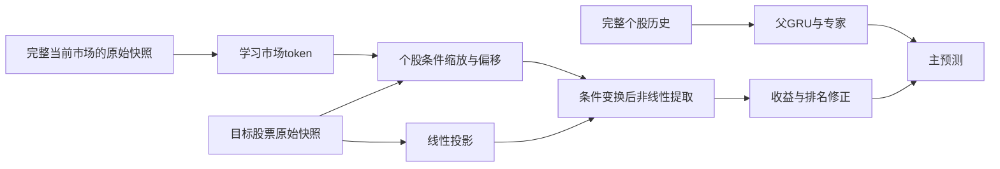

# v2601：原始市场条件参与个股特征提取

v260x 新系列首版，run 为 `v2601-raw-market-s42`，直接父版为 v1601，设计以其已完成结果为基准。从seed42重新初始化，保留完整个股GRU路径，增加原始市场条件分支。共 **3,372,499参数**，较父版增加 **853,507（约33.88%）**。正式双集评估已完成，验证／测试IC为 **0.102929／0.113144**，低于父版v1601与当前最优v2401，不导出平台材料。

[研究依据](../../docs/early-market-context-research-20261023.md)复查已有晚期市场交互负结果、FiLM机制和近期金融论文。本版不假定条件化必然提高IC均值；它同时检验原始分支条件化、完整上下文与日期内多次更新，不作单组件归因。设计时不叠加当时尚未完成评测的v2401、v2501模块。

## 模型与信息流

父75通道、1／5／30分钟的480／288／168根完整窗口、192维分层GRU、三频融合和四专家均保留。新增分支按每个预测截点取最近8／6／4根原始观测，共18个位置、每个75通道，形成1350维快照；这是原字段及已有规范化视图，不是手工技术指标。

| 部分 | 实现 |
| --- | --- |
| 市场输入 | 当日成员并集的八时点快照，逐时点使用当时股票池掩码；不按未来标签可用性删股票 |
| 集合表示 | 拼接已知八维预测时钟，编码到128维，末层tanh；16个学习token按完整当前截面聚合 |
| 个股条件 | 各股票以自身原始状态为查询，用四头注意力读取市场token，生成逐特征缩放与偏移 |
| 原始分支 | 快照和时钟先线性投影到256维，施加条件后再GELU和后续MLP；条件会改变特征提取 |
| 输出组合 | 新分支输出收益／排名修正，共同加到原四个专家与混合预测；残差尺度初值0.1 |
| 初始状态 | 条件层初始为恒等变换，新分支末层零初始化；父参数与主预测初始逐值一致 |

新增分支中的条件变换为 \(\widetilde h=(1+\gamma)\odot h+\beta\)，随后进入非线性。\(\gamma\) 和 \(\beta\) 从当前已知市场状态学习；没有行业、股票身份或exposure嵌入。只给所有股票加同一个常数不能改善截面IC，本版条件作用于各股不同的原始特征。

## 完整上下文与训练组织

上下文和监督目标分别组织：每个日期先收集完整成员的原始快照，再将有监督资格的目标股票日分成最多64个一批，同日多次优化。未提供完整上下文的模型调用会被拒绝，不能偷偷把目标批量当作市场集合。

原始快照可在同日各次更新之间复用；学习到的128维表示与市场token每步重算。训练禁止传入缓存的学习后市场状态。各预测时点独立做集合运算，未来时点的行情或成员不能影响早时点输出。

[真实训练元数据核对](../../experiments/v2601-market-context-budget.json)得到970个训练日、970,000个上下文股票日、967,872个有监督资格股票日，最大每日上下文为1000股。默认64目标股票日批量对应每遍历 **15,520次更新**；父版全局混合日期为15,123次。本版没有退化成一日只更新一次。

主Huber、排名、专家和路由损失项保持；日期权重的归约方式明确改变。由于同日批内权重相等，沿用批内权重和归一化会使日期衰减相消。本版保留原半衰期730天、下限0.25，将当前日期的原权重除以全部训练日历的平均原权重，再乘到目标批损失。当前数据的归一化常数约为 **0.6564025948**，来源仅为训练日历。

因此，训练次序和日期加权实现也是研究变量，不能声称与父版只有结构差异。训练标签仍直接使用原 `vwap_return` 的既有标准化／排名加工，不重算或合并收益，不使用exposure。EMA、验证IC选模、动态早停及一次正式训练保持。

## 缓存、推理与资源

[兼容性核对](../../experiments/v2601-input-cache-compatibility.json)确认基础训练／验证／测试缓存仍为 `c760f388…`、`b51e456d…`、`749e20cf…`。基础窗口和标签相同不表示模型整体信息流相同；市场上下文在批次组织层新增。没有新的全量行情或目标数组，也不落地全量学习表示。

1000股、八时点的原始FP32快照为 **43.2 MB（约41.20 MiB）**，这是一个原始上下文张量的大小，不是设备或进程峰值。主机预留 **2GiB**；上下文读取按128股票日分块，训练目标批64，推理目标批128。只为目标批运行完整GRU，市场条件网络读取全体原始快照；没有在每个更新中为全市场重复运行GRU。

[默认入口](v2601_predict.py)与[fast入口](v2601_predict_fast.py)相同。推理权重固定后，每日市场表示和token只准备一次，再按目标股票分批共享；[参考入口](v2601_predict_reference.py)逐样本编码个股，并在目标批间重新计算市场表示。当前成员掩码、股票置换、目标批量和部分日内请求均保持同一预测语义，不增加行情查询种类。

默认规模CPU预检使用 **1000个上下文股票日**，训练目标2个、推理目标4个；三次优化步约 **0.734／0.764／0.745秒**。这不是GPU64／128目标批量的吞吐，不能与其他上下文规模的CPU结果直接作速度比；GPU预检和正式开销由训练session记录。

若晋级，完整精度文本参数按单文件50 MB上限分片。文本读取器及Notebook支持 `state_dict_shards`，不使用二进制包装或运行时哈希校验。推理源码须包含 `v2601_market.py`、`v2601_grouped.py` 和 `v2601_context.py`；训练用的 `v2601_training_market.py` 不需要在平台推理时执行。当前没有生成未评测方案的提交材料。

## 验证与诊断

[实现记录](../../experiments/readiness/v2601.json)包含15项CPU合成检查：

- [模型检查](../../tests/test_v2601.py)：默认规模和完整1000股预检输入；零修正时父参数及预测一致；非初始条件参数下所有时点未来梯度隔离、其他股票实际影响、非成员隔离、逐时点参考；股票置换、分批和eval状态共享；训练逐步重算、CPU BF16有限梯度；文本分片及完整训练恢复。
- [上下文和采样](../../tests/test_v2601_context.py)：保留无标签股票、上下文不读取标签、原始观测重建不消耗RNG；同日多批、尾批和合法恢复游标；跨日期混批拒绝；日期加权不会在批内相消。
- [完整合成入口](../../tests/test_v2601_entrypoint.py)：月度FP32、全局混合精度、选模和完整双集输出；一日六个目标股票日实际执行六次更新，与逐样本完整市场参考一致。
- [平台入口](../../tests/test_v2601_predict.py)：非初始市场条件、动态成员和无自身统计股票；整日24行、部分9行，fast／参考及拆分请求一致，不查询标签或exposure。

记录原始主损失、日期倍数、修正和总预测的同钟批内去均值RMS、缩放偏离恒等值和偏移的RMS。它们是raw训练批统计，不能当作正式截面IC、市场模块的因果贡献或平台成绩。正式完成后按原协议比较父版及当时最优，报告全部月份、时点、覆盖、资源成本和距双集IC0.25的差距。

## 冻结结果

2026-10-24（UTC+08:00）完成一次正式训练，共九轮，按验证IC选中第5轮EMA。权重SHA-256为`3dadbddaa8f2ea6f3741349113f16a8214f74dd9511f290f3e3f7629f826891e`；[完整比较](../../experiments/v2601-gru.json)包含父版、当前最优、逐月和资源证据。双集覆盖及最低截面覆盖均100%，未定义IC截面为零。

| 指标 | 验证集 | 测试集 |
| --- | ---: | ---: |
| IC | 0.102929 | 0.113144 |
| Rank IC | 0.100931 | 0.102607 |
| IC IR | 0.824865 | 0.791031 |
| Rank IC IR | 0.886773 | 0.786775 |
| IC相对父v1601 | −0.002597 | −0.003116 |
| IC相对最优v2401 | −0.004849 | −0.006208 |
| 距0.25 | 0.147071 | 0.136856 |

相对v2401，两个区间各六个月IC全部下降，Rank IC验证仅2／6、测试0／6个月提高；测试八个时点的IC和Rank IC也全部下降。相对父v1601，IC双集各仅1／6个月提高，八个时点各3个提高，局部改善不足以支持整体晋级。09:30 IC为0.028283／0.026873，低于父版和当前最优；完整[时点与目标差距诊断](../../experiments/v2601-ic-target-gap.json)保留全部结果。

完整上下文为970,000股票日，具有监督的为967,872组，每轮15,520次日期内更新，九轮共139,680次；无标签成员未被删除，日期归一化常数0.6564025948166501经独立核验。最佳第5轮raw市场修正RMS为0.031648、预测RMS为0.148557，调制尺度偏离／平移RMS为0.224199／0.196603。分支不是始终零输出，但这些训练统计不是EMA消融，不能解释为市场条件的独立收益贡献。

第5至9轮raw主Huber从0.431707降至0.425116，验证EMA IC从0.102929降至0.093006。九轮训练及验证 **164.22分钟**，壁钟168.45分钟；相对父版八轮总量增加37.54%，平均每轮增加22.26%，其中也包含日期内更新与准备成本。基础输入缓存复用，未新增完整行情缓存。本地[换手代理](../../experiments/v2601-signal-diagnostics.json)为0.662466／0.662200，较父版和v2401更高；代理不等于官方成本或综合分。

本版不导出。结果削弱当前原始市场条件、个股分支和日期内训练的组合，不单独归因FiLM或市场信息，也不据此否定所有跨股票机制。后续不自动扫描token数、分支宽度或延长本版训练。已有公榜观察仍缺精确run／权重绑定，平台最优参照为空。
